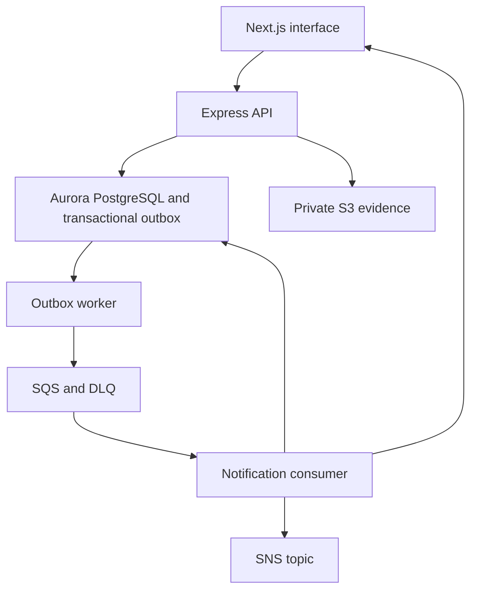

# Architecture

The web application is a Next.js App Router client of one modular Express API. Shared Zod schemas define report/auth contracts; shared transition rules drive allowed UI actions and server enforcement. Authentication-sensitive operations stay in Express. The browser holds its access token in memory and a same-site HttpOnly refresh cookie rotates through the API.

Sequelize targets Aurora PostgreSQL for the AWS demonstration. SQLite is a deliberate local/test emulator so a demonstration requires no cloud database. The API never switches a production runtime to SQLite. Migration creation uses QueryInterface rather than auto-sync.

Incident creation and transitions insert domain events in the same transaction as the write. One outbox loop either delivers locally or sends to SQS. A queue consumer builds idempotent in-app notifications and publishes critical events to SNS. External delivery remains at least once. WebSocket messages contain incident IDs and trigger authorized REST refetches; clients cannot join arbitrary operational rooms.

The browser API client handles timeouts, error normalization and refresh serialization. Mutations use explicit client IDs where replay matters. Queue reads are paginated. The dashboard uses server aggregation rather than loading the complete database.

The initial UI is an operational console with blue navigation, text-labelled severity states, keyboard-accessible controls and focus-trapped dialogs. Maps are dynamically imported. Shared tokens live in `apps/web/app/globals.css`; there are no remote font dependencies.
